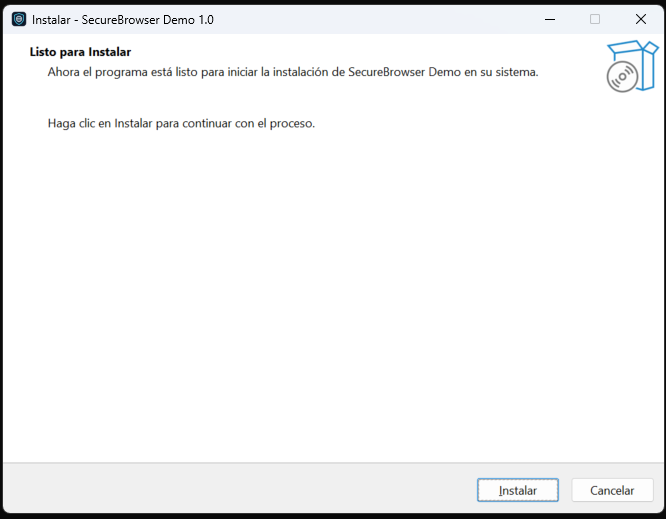
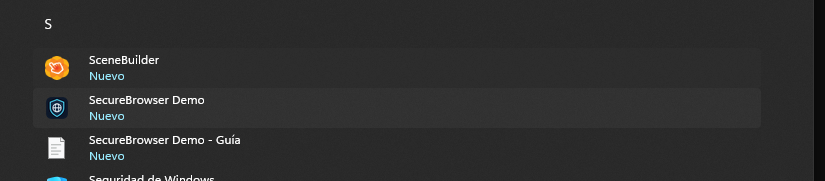
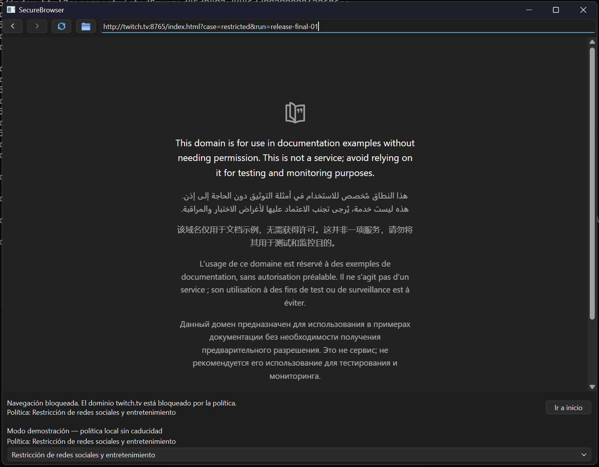

# Matriz de evidencias del TFG

**Evaluación actualizada el 28 de noviembre de 2026.** Las pruebas de las dos guías parten de `e02ef6754008`, la revisión que incorporó el instalador a `main` el 27 de noviembre. Cada fila identifica la revisión de su prueba o del registro que la describe. Un resultado de una PR anterior conserva su fecha y su alcance. Las instrucciones están en la [guía visual de la demo autónoma sin backend](entrega/GUIA_EVALUACION_DEMO_AUTONOMA.md) y en la [guía de evaluación con backend, Android y Desktop](entrega/GUIA_EVALUACION_COMPLETA.md).

**Lectura del estado.** *Acreditado* indica que existe un resultado localizable, incluido un fallo de CI. *Pendiente de captura* indica que hay un registro del recorrido y falta su figura, o que la fila documenta exclusivamente la figura solicitada. *No verificado* requiere una observación que falta. *Aplazado* identifica alcance futuro. Las cifras de distintas suites o revisiones no se suman.

## Evidencias y alcance

| Identificador de evidencia | Funcionalidad o requisito | Componente | Issue/PR que lo implementa | Commit o versión verificada | Prueba realizada | Resultado acreditado | Tipo de prueba | Captura o registro asociado | Apartado de la memoria | Estado |
| --- | --- | --- | --- | --- | --- | --- | --- | --- | --- | --- |
| EV-01 | R08F01/F03 · Persistencia y arranque reproducible | Compose, Spring, PostgreSQL | [#75][p75] | `a5b0fd8`, entrega del bloque 5 | Colección Postman al arrancar y después de recrear los contenedores conservando el volumen | 28 comprobaciones correctas en cada pasada local. El resultado posterior de CI figura en EV-15. | E2E manual | [Registro de entrega][p75] · CAP-01 | 5.4, 5.6, 7.1, 8.3 · C/D/E | acreditado |
| EV-02 | R01 · Sesiones, permisos y pertenencia | API, PostgreSQL | [#52][p52], [#66][p66] | `e02ef6754008` | Suites de autenticación HTTP y servicio con persistencia | `AuthApiPersistenceTest` 31 casos y `AuthServicePersistenceTest` 25, sin fallos, errores ni omisiones en Maven. | automática | [Log Maven][backend-ci] | 4.3, 7.1, 8.1, 8.3 · A/D | acreditado |
| EV-03 | R02/R03 · Compañía propia, dispositivos, consulta y edición de políticas | API, PostgreSQL | [#54][p54], [#69][p69], [#71][p71] | `e02ef6754008` | Suites HTTP con persistencia de Company, Device y Policy | Pasaron 14, 32 y 58 casos respectivamente. El MVP permite consultar la asignación y modificar una política existente. | automática | [Log Maven][backend-ci] · [contratos REST](architecture/rest-api-contracts.md) | 4.2–4.4, 5.2–5.4, 7.1, 8.1 · A/C/D | acreditado |
| EV-04 | R06F01/F02 · Recepción e historial de eventos | API, PostgreSQL | [#73][p73] | `e02ef6754008` | Suite `SecurityEventApiPersistenceTest` | 75 casos de la API con persistencia pasaron. El recorrido con clientes reales se registra en EV-09. | automática | [Log Maven][backend-ci] | 4.3, 7.1, 8.1, 8.3 · C/D | acreditado |
| EV-05 | R07/R08 · Abrir el proyecto Android y ejecutar Debug | Android Studio, APK | [#147][p147], [#156][p156] | APK debug 1.0 de `f04f8ef` | Instalación en emulador y móvil físico | Apertura del login en ambos según AND-10. El recorrido autenticado se documentó en el emulador. | manual | [APK, huella y entorno][and10] · CAP-02a/b para la preparación del entorno de evaluación | 6.4, 7.5, 8.4 · B/D/E | acreditado |
| EV-06 | R03F02/R07 · Administración y consulta por rol | Android, API | [#153][p153], [#155][p155], [#156][p156] | APK de `f04f8ef`, Medium Phone API 36.1 | ADMIN guardó y volvió a consultar las reglas. USER consultó desde su dispositivo. Se comprobó el PATCH directo por rol. | Cambios visibles para ambos. PATCH de USER rechazado con 403. Regla inválida de ADMIN rechazada con 400 y política anterior conservada. | E2E manual | [Recorrido por roles][and10] · CAP-03/04 | 5.5, 7.5, 8.1, 8.4, 10.1 · A/B/D | acreditado |
| EV-07 | R01/R03F03/R04 · Aplicación de política asignada | Desktop, API, Android | [#157][p157] | `2cb11ca`, revisión del E2E | Login de USER, resolución del dispositivo por UUID y actualización de la política tras editarla en Android | El título mostró la política. Al actualizar, CEF retiró la página que acababa de quedar bloqueada. | E2E manual | [Verificación #157][p157] · CAP-05 | 3.3, 5.1, 7.6, 8.2, 10.1 · D/E | acreditado |
| EV-08 | R04F02/R05F01 · Dos bloqueos y vuelta a Inicio | Desktop conectado | [#157][p157], [#161][p161] | Release documentada en #161, fusión `80dfa05` | Visitar `as.com` e intentar una descarga PDF con sus reglas de bloqueo. Confirmar cada diálogo. | Motivo y política visibles. OK devolvió a Google. Con el propio Inicio bloqueado, el aviso se cerró sin bucle. | E2E manual | [Tabla de verificación][p161] · CAP-06/07 | 5.5, 7.2–7.3, 7.6, 8.2–8.4, 10.1 · B/D | acreditado |
| EV-09 | R06F03/R07F02 · Dos eventos desde CEF hasta Android | Desktop, API, Android | [#154][p154], [#158][p158] | Pasada de 26-11-2026 en #158, fusión `4acca3c` | Bloquear una URL y una descarga en Desktop. Consultar el historial como ADMIN. | Android mostró ambos para el dispositivo 1. URL a las 11:11:04.545688 UTC y descarga a las 12:12:58.854905 UTC. | E2E manual | [Registro fechado de ambos eventos][p158] · CAP-08 | 5.1, 7.5–7.6, 8.3–8.4, 10.1 · B/D | acreditado |
| EV-10 | R04F03 · Selector de políticas autónomas | Desktop | [#132][p132] | Registro de entrega `4b843ba` | Recorrido Libre → Restrictiva → Libre en Windows, Debug y Release | Se acreditaron el cambio de política y el bloqueo por dominio. CAP-10 corresponde a la pasada histórica Release. | manual | [Registro por configuración][url-reg] · CAP-10 | 3.3, 5.5, 7.3–7.4, 8.4 · B/D/E | acreditado |
| EV-11 | R05 · Nombre sugerido y definitivo, cancelación y cierre | Desktop, CEF y Qt | [#134][p134] | `d723b99` | Guardar y renombrar archivos de prueba, cancelar el diálogo, provocar fallo y cerrar | El registro identifica por configuración los guardados, bloqueos y cierres. También describe la pasada del ZIP extraído. | manual | [Comprobaciones y entornos][dl-reg] | 7.2–7.4, 8.2–8.4, 10.1 · D | acreditado |
| EV-12 | R04/R08 · Bloqueo de contenido incrustado y cierre coordinado | Desktop Debug y Release | [#120][i120], [#132][p132] | Pasadas de 26-11-2026, logs por configuración | Bloquear un marco manteniendo abierta la página principal, repetir y cerrar con la X | Un aviso visible, ninguna petición posterior al marco, salida Qt 0, CEF cerrado y cero procesos activos. | manual | [Comentario con ambos logs][i120] | 5.5, 7.2, 8.4, 10.1 · D | acreditado |
| EV-13 | R04F03/R05F01/R08F03 · Distribución y prueba desde el instalador | Windows 11 x64, Desktop | [#167][p167] | `c611ce4`, Inno Setup 7.1.1 | Instalar por usuario, abrir desde Inicio, cambiar de política, bloquear PDF renombrado a EXE, cerrar y desinstalar | 311 archivos de manifiesto verificados. YouTube cargó en Libre, se bloqueó en Restrictiva y OK volvió a Google. Se bloqueó `prueba.exe`. Desinstalación comprobada en el equipo de desarrollo. | E2E manual | [Huella SHA-256, inventario y log del instalador][p167] · CAP-09 | 7.4, 8.4–8.5, 10.1 · B/D/E | acreditado |
| EV-14 | R08F02 · Compilación y comprobaciones de clientes | Desktop y Android | [#112][p112], [#147][p147] | Desktop `e02ef6754008`, Android `0a6871f` | Ejecuciones de Actions en sus respectivas revisiones | Desktop CI y Android CI finalizaron correctamente en las dos revisiones indicadas. | automática | [Desktop CI][desktop-ci] · [Android CI][android-ci] | 6.5, 8.3–8.4 · D | acreditado |
| EV-15 | R08F02/F03 · CI del backend en la entrega | Backend, Compose | [#75][p75], [#167][p167] | `e02ef6754008`, ejecución 45981378100 | Maven y etapa posterior de Compose/Postman | **1.143 pruebas Maven, 0 fallos, 0 errores, 0 omitidas. El workflow falló** en `Verify Compose delivery and Postman after recreation`, salida 1 de `verify-compose.sh`. Esta ejecución no acredita la recreación. | automática | [Backend CI, ejecución concreta][backend-ci] | 8.3–8.5, 10.1–10.2 · D | acreditado |
| EV-16 | R04/R05 · Vigencia y retirada de autorización, cobertura parcial | Núcleo Desktop y cliente REST | [#128][p128], [#134][p134], [#157][p157] | Suites del árbol `e02ef6754008` y pasada `d723b99` | Reloj controlado en el límite de 15 min, respuestas del GET de política y retirada de contexto con diálogo pendiente | Cobertura acotada a caducidad, clasificación de denegaciones y descarte del diálogo pendiente. | automática | [Prueba de vigencia](../desktop/tests/security/policy_manager_test.cpp) · [respuestas del GET](../desktop/tests/rest/auth_device_policy_test.cpp) · [regresión CEF][dl-reg] · [Desktop CI][desktop-ci] | 7.3, 8.2–8.5 · D | acreditado |
| EV-17 | R04 · Navegar con autorización previa tras desconectar el backend | Desktop conectado | [#123][i123], [#157][p157] | Sin pasada manual identificada | Con política vigente ya aplicada, desconectar el servicio e intentar una **nueva navegación permitida** dentro de su vigencia | **No confirmada manualmente.** El error al actualizar y la prueba de reloj de EV-16 no observan esa navegación. | manual | Sin registro del recorrido | 8.5, 10.2 · D | no verificado |
| EV-18 | R05F03 · Cancelar una transferencia activa al desactivar el dispositivo | Desktop conectado, backend | [#123][i123], [#134][p134], [#157][p157] | Sin pasada manual identificada | Con la descarga ya autorizada y en curso, desactivar el dispositivo, actualizar y observar la transferencia tras la denegación | **No confirmada manualmente.** Añadir `pdf` a una política durante una transferencia autorizada cambia una regla. La revocación del dispositivo es otra operación. | E2E manual | Sin registro del recorrido. Cobertura parcial en EV-16. | 7.3, 8.5, 10.2 · D | no verificado |
| EV-19 | R06 · Persistir eventos sin conexión y emitir aplicación de cambios de política desde Desktop | Desktop | [#124][i124], [#160][i160] | Trabajo futuro | Sin pasada de aceptación de esas funciones | El MVP conectado envía los dos bloqueos de EV-09. SQLite y la emisión de `POLICY_UPDATED` por Desktop tienen seguimiento propio. | E2E pendiente | [Alcance acordado][p158] | 3.2, 8.5, 11 · A | aplazado |

## Correspondencia entre las guías y la memoria

| Recorrido de la tutora | Evidencias y figuras | Destino académico |
| --- | --- | --- |
| Preparar el entorno y comprobar los servicios (paso 1) | EV-01–04, EV-15 · CAP-01 | Despliegue en 5.4, 5.6 y 7.1. Registros en 8.3–8.4 y D. Comandos en E. |
| Abrir Android y entrar como ADMIN (paso 2) | EV-05/06 · CAP-02/03 | Interfaz en 5.5 y 7.5. Roles en 8.1 y figuras en B. |
| Iniciar Desktop como propietario (paso 3) | EV-07 · CAP-05 | 3.3, 5.1 y 7.6 para la obtención de la política del dispositivo. |
| Editar reglas, actualizar y comprobar bloqueos (paso 4) | EV-06–08 · CAP-04/06/07 | Resultados en 7.3, 7.5–7.6 y 10.1. El anexo A vincula R03, R04 y R05. |
| Identificar los eventos y restaurar el entorno (paso 5) | EV-01/09 · CAP-08 | Recorrido completo en 7.6 y 10.1. D conserva el registro y E explica la limpieza. |
| Instalar y probar la demo autónoma | EV-10/11/13 · CAP-09/10 | Modo local e instalador en 3.3 y 7.4. Entorno probado en 8.4–8.5, con apoyo de B/D/E. |

**CAP-01 · Arranque del entorno conectado.** El 28/11/2026 se comprobó en el clon de evaluación (`e02ef6754008`) que ambos servicios estaban sanos, que la API se publicaba en `127.0.0.1:8081` y que PostgreSQL aceptaba conexiones. La captura complementa EV-01 con una observación del arranque local. [Captura original de los servicios](entrega/capturas/CAP-01-servicios-docker.png)

**CAP-02 · Apertura del proyecto Android y selección del emulador.** El 28/11/2026 se documentaron la carpeta `android` del clon de evaluación y los controles previos al arranque. En la segunda vista se leen el dispositivo y la configuración, junto al botón Run. [CAP-02a. Selección de carpeta](entrega/capturas/CAP-02a-seleccion-android.png) · [CAP-02b. Barra de ejecución](entrega/capturas/CAP-02b-emulador-app-run.png)

**CAP-03 · Panel de administración en Android.** El 28/11/2026, tras entrar como `admin@demo.local` en el emulador, se mostró el rol ADMIN con accesos a dispositivos, catálogo e historial. El guardado de reglas y el envío de eventos se documentan por separado en EV-06 y EV-09. [Captura del panel autenticado](entrega/capturas/CAP-03-panel-admin.png)

**CAP-04 · Edición del filtro de URL en Android (EV-06).** El 28/11/2026, antes de guardar, el editor de **Política demo** mostraba el filtro activado en modo **Lista de bloqueo**, con `as.com` debajo de `blocked.example`. [Captura del editor de la política](entrega/capturas/CAP-04-regla-url-android.png)

**CAP-04b · Confirmación del guardado en Android (EV-06).** El 28/11/2026, el detalle de **Política demo** mostró «Cambios confirmados». Se veían `as.com` y `pdf` junto a las reglas previas, `blocked.example` y `exe`, con ambos filtros activados en modo de bloqueo. [Captura del detalle tras guardar](entrega/capturas/CAP-04b-cambios-confirmados-android.png)

**CAP-05 · Aplicación de la política en Desktop (EV-07).** El 28/11/2026, el título de la ventana mostró **Política aplicada: Política demo**. La página de inicio era Google y el botón **Actualizar política** estaba visible. [Captura de la política aplicada](entrega/capturas/CAP-05-politica-aplicada-desktop.png)

**CAP-06 · Bloqueo de navegación en Desktop (EV-08).** El 28/11/2026, tras añadir `as.com` en Android y actualizar la política en Desktop, el aviso identificó el dominio y **Política demo**. La captura muestra `about:blank` con el aviso abierto. En la comprobación manual posterior, el evaluador confirmó que al pulsar **OK** Desktop volvió a `google.com`. [Página abierta antes del cambio](entrega/capturas/desktop-as-antes-del-bloqueo.png) · [Aviso de bloqueo](entrega/capturas/CAP-06-navegacion-bloqueada-desktop.png)

Al finalizar el recorrido, el evaluador restauró las reglas iniciales en Android y confirmó que, tras pulsar **Actualizar política** en Desktop, volvió a cargar la portada de `as.com`.

**CAP-07 · Bloqueo de una descarga PDF en Desktop (EV-08).** El 28/11/2026, con `pdf` en la lista de extensiones bloqueadas de **Política demo**, Desktop mostró el aviso de descarga bloqueada por extensión en Samplelib. El evaluador confirmó que al pulsar **OK** Desktop volvió a Inicio. [Regla confirmada en Android](entrega/capturas/CAP-04b-cambios-confirmados-android.png) · [Aviso de bloqueo en Desktop](entrega/capturas/CAP-07-descarga-bloqueada-desktop.png)

**CAP-08 · Historial de eventos en Android (EV-09).** En la evaluación del 28/11/2026, el historial con el filtro **Todos** mostró dos eventos del **Dispositivo 1**: **URL bloqueada** a las 11:09:52.186442 UTC y **Descarga bloqueada** a las 11:13:24.822835 UTC. [Captura del historial](entrega/capturas/CAP-08-historial-bloqueos-android.png)

Las capturas CAP-01 a CAP-08 acompañan los pasos del recorrido en la [guía con backend](entrega/GUIA_EVALUACION_COMPLETA.md).

**Preparación del entorno (anexo E).** El 28/11/2026 se registró la ejecución del bloque de PowerShell que genera la clave JWT y la copia al portapapeles. La captura muestra el retorno al prompt. La comprobación de los servicios de Docker corresponde a CAP-01. [Captura de PowerShell](entrega/capturas/preparacion-clave-jwt-powershell.png)

**Cierre del entorno conectado (paso 5, anexo E).** El 28/11/2026, Docker Compose indicó `Removed` para los dos contenedores de evaluación y su red. [Captura del cierre en PowerShell](entrega/capturas/cierre-entorno-docker.png)

**CAP-09a · Asistente de instalación de la demo autónoma (EV-13).** El 28/11/2026, el asistente de **SecureBrowser Demo 1.0** mostró «Listo para Instalar» y el botón **Instalar**. Corresponde al primer paso de «Instalación e inicio» en la [guía de la demo](../desktop/distribution/LEEME-demo.txt).

**CAP-09b · Accesos desde el menú Inicio (EV-13).** El 28/11/2026, tras instalar la demo, en la letra **S** del menú Inicio de Windows aparecieron dos accesos: **SecureBrowser Demo** y **SecureBrowser Demo - Guía**.

**Arranque de la demo instalada (EV-13).** El 28/11/2026, la ventana mostró Google como página de inicio y el panel inferior indicó «Modo demostración — política local sin caducidad» con **Navegación libre** seleccionada. [Captura del arranque](entrega/capturas/demo-autonoma-inicio-libre.png)

**YouTube con Navegación libre (EV-10/13).** El 28/11/2026, la demo instalada cargó `https://www.youtube.com/`. El selector de políticas visible en la misma ventana mostraba **Navegación libre**. [Captura de YouTube antes del cambio de política](entrega/capturas/demo-autonoma-youtube-libre.png)

**YouTube con la política restrictiva (EV-10/13).** En la misma prueba, al seleccionar **Restricción de redes sociales y entretenimiento**, el aviso de seguridad identificó `www.youtube.com` como dominio bloqueado. El evaluador confirmó que al pulsar **OK** volvió a Google. [Captura del aviso en la demo instalada](entrega/capturas/demo-autonoma-youtube-bloqueado.png)

**Wikipedia con la política restrictiva (EV-10/13).** El 28/11/2026, la demo cargó `https://www.wikipedia.org/` con **Restricción de redes sociales y entretenimiento** seleccionada. [Captura del dominio permitido](entrega/capturas/demo-autonoma-wikipedia-restrictiva.png)

Al terminar la prueba, el evaluador confirmó que, al volver a seleccionar **Navegación libre**, pudo abrir YouTube de nuevo.

**Descarga permitida con la política restrictiva (EV-11/13).** El 28/11/2026, durante la prueba del PDF de Samplelib, la demo instalada mostró «Descarga completada» con **Restricción de redes sociales y entretenimiento** seleccionada. [Captura del resultado en Desktop](entrega/capturas/demo-autonoma-descarga-pdf-completada.png)

**Bloqueo por extensión al guardar (EV-11/13).** En el segundo intento de descarga del PDF de Samplelib, SecureBrowser mostró «Descarga bloqueada» e identificó la extensión del archivo como motivo. El diálogo y el selector inferior mostraban **Restricción de redes sociales y entretenimiento**. [Captura del aviso antes de pulsar OK](entrega/capturas/demo-autonoma-descarga-extension-bloqueada.png)

Tras pulsar **OK**, el evaluador confirmó la vuelta a Google y comprobó en el Explorador que `prueba.pdf` seguía en la carpeta de destino y que no se había creado `prueba.exe`.

**CAP-10 · Política restrictiva de la demo autónoma.** La captura Release de #132 muestra la política seleccionada y el bloqueo de Twitch. El aviso inferior corresponde a la interfaz de esa revisión. También se conserva la [vista Debug](../desktop/docs/evidence/url-filtering-demo/qt-block-notice-debug-final-01.png). [Registro de la pasada][url-reg]

## Propuesta de actualización por capítulos

La numeración sigue la memoria de trabajo. El plan distingue el contenido que ya puede conservarse de los cambios que requieren la revisión del autor. Las referencias a R01–R08 mantienen los identificadores de su RFTP.

| Capítulo | Qué conservar | Qué corregir o ampliar y con qué evidencia |
| --- | --- | --- |
| Portada e índices | Plantilla, estilos y jerarquía existentes. | Confirmar curso y datos administrativos con el centro. Actualizar los campos del índice general al final de la maquetación y generar los índices de figuras y tablas con los pies definitivos. |
| 1. Resumen / Abstract | Las dos versiones y la descripción de los tres componentes. | Alinear ambos resúmenes con dos resultados demostrados: cambio centralizado aplicado y dos eventos consultados (EV-07–09). Mencionar la distribución Windows (EV-13). |
| 2. Justificación | Motivación personal, destinatarios y razón para crear la demo local. | En 2.2 apoyar la comparación con las referencias originales. En 2.3 distinguir el público potencial del entorno académico realmente probado. |
| 3. Introducción | Separación de modos y alcance de los controles. | Actualizar 3.2–3.3: la integración conectada ya se demostró. Precisar qué necesita backend y cuándo interviene Internet en la demo local (EV-07–10, EV-19). |
| 4. Objetivos y requisitos | Objetivos, IDs R01–R08, desglose RFTP y criterios de aceptación. | Vincular cada objetivo a EV y marcar cumplimiento parcial. En R02 separar compañía propia, perfil y lectura de instalaciones de las altas/CRUD previstos. En R03 distinguir edición/asignación consultada de creación/reasignación. En R06 registrar los dos eventos entregados y la cola aplazada. Reflejar el instalador en R04/R08. |
| 5. Diseño de la solución | Seis diagramas de arquitectura, casos de uso, dominio, ER, navegación y despliegue. Ficha CU01 y esquema con diez tablas de dominio. | Revisar leyendas y flechas: Android edita, Desktop obtiene/aplica, Desktop envía eventos. Identificar el dispositivo preconfigurado de demo. Separar el modelo de inscripción de un alta interactiva implementada. Añadir direcciones del emulador y del host a 5.6 (EV-01, 03, 07–09). |
| 6. Tecnologías | C++20, Qt 6, CEF, CMake, Spring, PostgreSQL, Flyway y herramientas de pruebas. | En 6.4 describir el uso efectivo de Retrofit, OkHttp y Compose. En 6.5 incorporar Android CI e Inno Setup con la revisión observada (EV-05/13–15). |
| 7. Desarrollo e implementación | Capas del backend, ciclo Qt/CEF y evaluación de nombres sugerido y definitivo. | En 7.1 acotar las operaciones a los controladores reales. En 7.2–7.3 incluir diálogos y vuelta a Inicio (EV-08/11/12). En **7.4** añadir instalador, guía y conservación del ZIP (EV-10/13). En **7.5** presentar catálogo, edición e historial entregados (EV-05/06/09). En **7.6** seguir una petición de política y el viaje inverso del evento (EV-07–09). |
| 8. Seguridad y pruebas | Roles, separación por compañía, filtros y distinción de pruebas manuales y automáticas. | En 8.1 precisar JWT con HMAC-SHA256 (HS256). En **8.3** citar suites y E2E por separado. En **8.4** anotar revisión, entorno y fallo posterior a Maven. En **8.5** mantener los límites de origen/extensión, la vigencia en memoria y las dos observaciones pendientes (EV-14–19). |
| 9. Metodología y planificación | Kanban, ADR, estimación retrospectiva por requisito, presupuesto estimado y Gantt ya dibujado. | En **9.3** contrastar hitos y desviaciones con fechas de fusión. En **9.4** actualizar los tramos de Android, integración e instalador con #156 (23/11), #157 (25/11), #158 (26/11) y #161/#167 (27/11). Mantener separados cierre previsto y actividad observada. En **9.5** documentar hipótesis de tarifa y fuentes de gasto, si las hay. Las horas reales requieren un registro de dedicación. |
| 10. Resultados | Organización por componente y comparación con objetivos. | En **10.1** presentar los dos recorridos, el instalador y los resultados CI con su fecha. En **10.2** confrontar cada R01–R08 con las filas acreditadas, parciales y aplazadas. Evitar porcentajes de cobertura deducidos del número de pruebas. |
| 11. Trabajos futuros | Análisis de contenido, portapapeles, persistencia local, otros sistemas y validación más amplia. | Ubicar aquí SQLite y sincronización ([#124][i124]), renovación coordinada Android ([#151][i151]), aviso de aplicación de política en Desktop ([#160][i160]) y posibles altas o reasignaciones desde la interfaz. |
| 12. Conclusiones | Reflexión personal sobre Qt/CEF, arquitectura, planificación y aprendizaje. | Añadir un ejemplo concreto por aportación relevante, como EV-07/09/13. El autor debe validar las conclusiones personales. |
| 13. Referencias bibliográficas | Referencias actuales a documentación primaria y su aplicación. | Revisar la correspondencia cita–referencia y el formato APA de la plantilla. Incorporar las fuentes realmente usadas para el empaquetado y las versiones citadas. Mantener los registros de ejecución en D. |
| 14. Anexos | Estructura A–E y referencias existentes a contratos, modelo y guías. | **A** vincula el RFTP de 4.3 con los IDs EV. **B** indexa los diagramas del capítulo 5 y reúne las figuras CAP. **C** contrasta contratos diseñados con endpoints entregados. **D** indexa registros y revisiones de esta matriz. **E** enlaza por separado la guía autónoma distribuida con el instalador y la guía de evaluación con backend. |

**Datos que debe aportar o confirmar el autor.** Las fusiones permiten fechar entregas y el Gantt distingue actividad documentada de planificación. Para convertir estimaciones en horas o costes reales se necesitan partes de dedicación o justificantes. Quedan pendientes los pies definitivos y la revisión de legibilidad en la plantilla. La instalación en otro equipo limpio y los dos escenarios de EV-17/18 solo admitirían un resultado con un registro propio. [Verificación del instalador][p167]

[p52]: https://github.com/CristianPG1993/securebrowser-platform/pull/52
[p54]: https://github.com/CristianPG1993/securebrowser-platform/pull/54
[p66]: https://github.com/CristianPG1993/securebrowser-platform/pull/66
[p69]: https://github.com/CristianPG1993/securebrowser-platform/pull/69
[p71]: https://github.com/CristianPG1993/securebrowser-platform/pull/71
[p73]: https://github.com/CristianPG1993/securebrowser-platform/pull/73
[p75]: https://github.com/CristianPG1993/securebrowser-platform/pull/75
[p112]: https://github.com/CristianPG1993/securebrowser-platform/pull/112
[p128]: https://github.com/CristianPG1993/securebrowser-platform/pull/128
[p132]: https://github.com/CristianPG1993/securebrowser-platform/pull/132
[p134]: https://github.com/CristianPG1993/securebrowser-platform/pull/134
[p147]: https://github.com/CristianPG1993/securebrowser-platform/pull/147
[p153]: https://github.com/CristianPG1993/securebrowser-platform/pull/153
[p154]: https://github.com/CristianPG1993/securebrowser-platform/pull/154
[p155]: https://github.com/CristianPG1993/securebrowser-platform/pull/155
[p156]: https://github.com/CristianPG1993/securebrowser-platform/pull/156
[p157]: https://github.com/CristianPG1993/securebrowser-platform/pull/157
[p158]: https://github.com/CristianPG1993/securebrowser-platform/pull/158
[p161]: https://github.com/CristianPG1993/securebrowser-platform/pull/161
[p167]: https://github.com/CristianPG1993/securebrowser-platform/pull/167
[i120]: https://github.com/CristianPG1993/securebrowser-platform/issues/120#issuecomment-7194811118
[i123]: https://github.com/CristianPG1993/securebrowser-platform/issues/123
[i124]: https://github.com/CristianPG1993/securebrowser-platform/issues/124
[i151]: https://github.com/CristianPG1993/securebrowser-platform/issues/151
[i160]: https://github.com/CristianPG1993/securebrowser-platform/issues/160
[and10]: testing/and-10-android.md
[dl-reg]: ../desktop/tests/manual/download-control-demo/README.md
[url-reg]: ../desktop/docs/url-filtering-demo-validation.md
[backend-ci]: https://github.com/CristianPG1993/securebrowser-platform/actions/runs/45981378100
[desktop-ci]: https://github.com/CristianPG1993/securebrowser-platform/actions/runs/45981377966
[android-ci]: https://github.com/CristianPG1993/securebrowser-platform/actions/runs/45963934414
