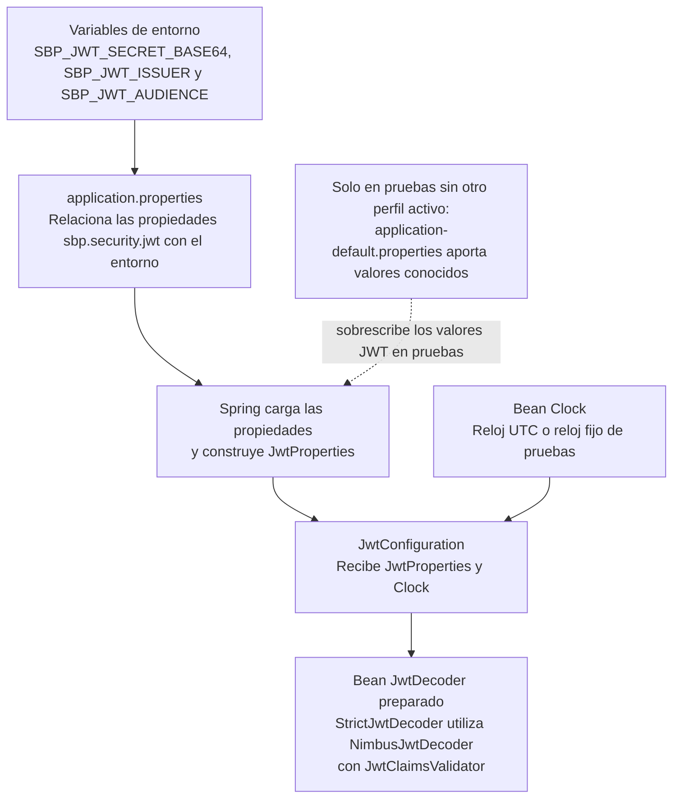
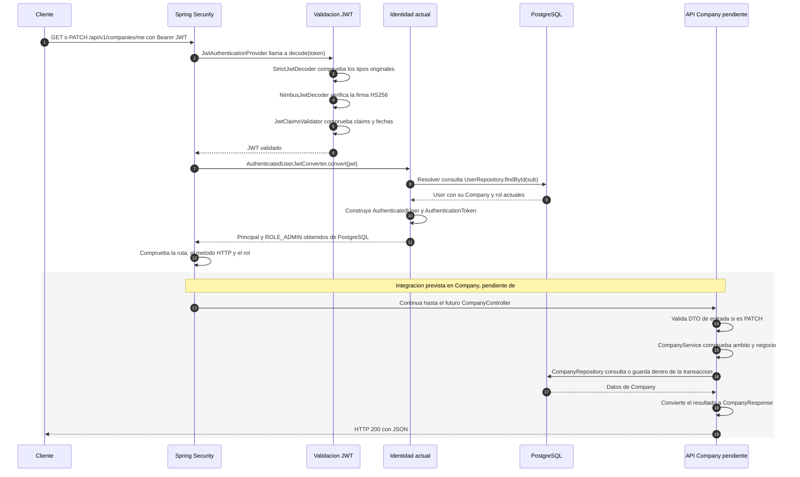

# Flujo de configuración y peticiones del backend

## Alcance y estado

Estos diagramas explican las clases de la integración JWT de la tarea #51.
La implementación está en la rama de trabajo. La suite completa ha pasado con
703 pruebas, sin fallos, errores ni pruebas omitidas, y se ha comprobado el JAR
generado. No describen un flujo de login ni de renovación de tokens.

Company ya dispone de entidad, repositorio, servicio y DTOs. Su Controller y la
adaptación del servicio al principal autenticado corresponden a #44; las pruebas
de su API corresponden a #45. El tramo final del segundo diagrama representa
esa integración prevista, no un endpoint ya disponible.

Los diagramas están escritos directamente en Mermaid y se visualizan al abrir
este documento en GitHub. Sus bloques son también la fuente editable.

## 1. Al arrancar: preparar los objetos

Spring carga la configuración y crea los beans. Todavía no está procesando el
JSON de una petición: está preparando los valores esperados y los componentes
que utilizará después.

Por ejemplo, `SBP_JWT_ISSUER=securebrowser-backend` acaba en
`JwtProperties.getIssuer()`. Ese es el emisor **esperado** que se comparará con
el claim `iss` de cada token. El prefijo no se obtiene del JSON del JWT.
`sbp.security.jwt.max-lifetime-seconds` permite configurar la duración máxima,
con 900 segundos como valor inicial.

`JwtConfiguration` registra el decodificador; `SecurityConfiguration` lo conecta
con el proveedor y el filtro Bearer de Spring Security. Los beans se reutilizan;
el usuario y sus permisos se consultan de nuevo para cada petición autenticada.

## 2. En cada petición: validar, identificar y autorizar

Este diagrama muestra el recorrido correcto de un ADMIN. Las respuestas de
rechazo se explican después para mantener legible la secuencia.

La columna **Identidad actual** agrupa `AuthenticatedUserJwtConverter` y
`AuthenticatedUserResolver`. El converter recibe un JWT ya validado; el resolver
consulta al usuario dentro de una transacción de solo lectura. La interacción
con PostgreSQL pasa por Spring Data JPA e Hibernate.

`AuthenticatedUser` contiene userId, companyId y role. El
`AuthenticatedUserAuthenticationToken` lo adapta a Spring Security y asigna
`ROLE_ADMIN` o `ROLE_USER`. Ese objeto interno no es otro JWT y no conserva
contraseñas ni el token como credenciales.

Los claims de rol o compañía no deciden los permisos: se utilizan los datos
actuales de PostgreSQL. Por eso un mismo JWT puede dejar de autorizar una
operación si el usuario cambia de rol o se elimina. No se guarda una sesión HTTP.

## Dónde se interrumpe una petición

| Situación | Resultado | Punto del recorrido |
| --- | --- | --- |
| No hay Bearer válido, falla la firma, el formato o los claims, o el token ha caducado | 401 con desafío Bearer | Antes de resolver el usuario. |
| La firma y los claims son válidos, pero User ya no existe | 401 con desafío Bearer | Al resolver la identidad. |
| PostgreSQL no está disponible, se agota el tiempo de espera o no se puede iniciar la transacción de resolución | 503 | Durante la resolución; no se omite esta consulta. |
| El usuario existe, pero su rol, ruta o método HTTP no están permitidos | 403 | Después de autenticar y antes del Controller. |

`SecurityAuthenticationEntryPoint` prepara los rechazos 401 y 503 sin detalles
internos. La cadena de seguridad responde 403 a los rechazos de permisos. El
formato común de errores, incluido Problem Details, corresponde a #46.

Actualmente, un ADMIN puede superar el filtro para GET/PATCH de Company, pero
todavía no existe su Controller real. Los tests de seguridad importan un endpoint
exclusivo de pruebas que observa el principal; no ejecuta el flujo Company del
tramo gris ni sustituye sus futuras pruebas de API.

## Cómo localizar cada responsabilidad

| Responsabilidad | Clases principales |
| --- | --- |
| Leer los valores esperados y preparar componentes | `JwtProperties`, `JwtConfiguration`, `SecurityConfiguration`. |
| Validar el token recibido | `StrictJwtDecoder`, `NimbusJwtDecoder`, `JwtClaimsValidator`. |
| Consultar la identidad actual | `AuthenticatedUserJwtConverter`, `AuthenticatedUserResolver`, `UserRepository`. |
| Representar la identidad y sus autoridades | `AuthenticatedUser`, `AuthenticatedUserAuthenticationToken`. |
| Decidir acceso HTTP y responder rechazos de seguridad | `SecurityConfiguration`, `SecurityAuthenticationEntryPoint`. |
| Procesar Company después de autenticar | Futuro `CompanyController`, `CompanyService`, `CompanyRepository` y DTOs. |

## Referencias

- [Organización del backend](backend-structure.md).
- [Diseño de autenticación JWT](jwt-authentication.md) y [ADR-0008](../adr/0008-jwt-authentication.md).
- [Autorización por Company](company-authorization.md) y [ADR-0009](../adr/0009-company-authorization.md).
- [Contratos REST](rest-api-contracts.md).
- [Configuración y pruebas del backend](../../backend/README.md).
