# Guía de evaluación con backend — Android y Desktop

En esta prueba cambiarás desde Android la política de un dispositivo. Añadirás un dominio y una extensión a sus listas de bloqueo. Después, en Desktop, pulsarás **Actualizar política** e intentarás abrir esa página y descargar un archivo con esa extensión.

Al terminar, podrás ver en Android los dos eventos que el navegador envió al backend. Para seguir el recorrido necesitas tener en marcha la API y su base de datos. El primer paso explica cómo iniciarlas.

## Requisitos y descargas para Windows

La evaluación se ha realizado en **Windows 11 x64**. Antes de empezar, comprueba qué herramientas tienes en tu equipo. Las tres últimas filas se utilizan para compilar el navegador Desktop desde el código fuente.

| Herramienta | Qué preparar | Descarga oficial |
| --- | --- | --- |
| Git para Windows | Instala la versión x64 para clonar el repositorio. | [Git para Windows](https://git-scm.com/install/windows) |
| PowerShell | Puedes usar **Windows PowerShell 5.1**, incluido en Windows 11. También sirve PowerShell 7. | [PowerShell 7 para Windows](https://learn.microsoft.com/es-es/powershell/scripting/install/install-powershell-on-windows) |
| Docker Desktop | Instala la edición de Windows x86_64 y utiliza contenedores Linux. Docker Compose preparará el backend y PostgreSQL. | [Docker Desktop para Windows](https://docs.docker.com/desktop/setup/install/windows-install/) |
| Android Studio | Para reproducir la prueba, usa JDK 21 para Gradle. Desde **SDK Manager** instala la plataforma **API 36.1**, las **Build Tools 36.0.0** y **Android Emulator**. En **Device Manager** podrás crear el dispositivo virtual **Medium Phone API 36.1**. | [Android Studio](https://developer.android.com/studio) · [SDK Manager](https://developer.android.com/studio/intro/update#sdk-manager) · [Entorno probado](../../android/README.md#entorno-de-compilación) |
| **Visual Studio Build Tools 2022** | Proporciona el compilador de C++. Selecciona la carga de trabajo y el componente indicados debajo de la tabla. | [Descargar Build Tools 2022 (.exe)](https://aka.ms/vs/17/release/vs_buildtools.exe) |
| Python 3.10 o posterior | Durante la preparación de Qt se utiliza el comando `python` con `venv` y `pip`. | [Python para Windows](https://www.python.org/downloads/windows/) |
| 7-Zip x64 | Elige el instalador **Windows x64**. Se utiliza para extraer el paquete de CEF. | [7-Zip para Windows](https://www.7-zip.org/download.html) |

### Instalar el compilador de C++

1. Abre el instalador **Build Tools 2022** de la tabla. Si ya tienes Visual Studio 2022 o Build Tools 2022, abre **Visual Studio Installer** y pulsa **Modificar** en esa instalación.
2. En **Cargas de trabajo**, marca **Desarrollo para el escritorio con C++** (*Desktop development with C++*).
3. En **Detalles de la instalación**, comprueba que está seleccionado **MSVC v143 – VS 2022 C++ x64/x86**. Pulsa **Instalar** o **Modificar** y espera a que termine. En el apartado 3 de esta guía comprobarás que PowerShell encuentra las herramientas. [Instrucciones de Microsoft](https://learn.microsoft.com/es-es/cpp/build/vscpp-step-0-installation?view=msvc-170)

El proyecto incluye scripts para preparar las versiones concretas del Windows SDK, CMake, Qt, CEF e ICU durante la compilación de Desktop. [Herramientas y dependencias de Desktop](../../desktop/README.md#preparar-las-herramientas)

## 1. Preparar el equipo y los servicios

En el Explorador de archivos, crea una carpeta llamada `EvaluacionTFG` donde prefieras, por ejemplo, en el Escritorio. Abre esa carpeta y, desde ella, abre una terminal de PowerShell. Ejecuta el siguiente bloque para descargar el proyecto y preparar su archivo de configuración.

```powershell
git clone https://github.com/CristianPG1993/securebrowser-platform.git
Set-Location securebrowser-platform
if (-not (Test-Path -LiteralPath .env)) { Copy-Item -LiteralPath .env.example -Destination .env }
```

Ejecuta los comandos siguientes desde esa carpeta. En ella encontrarás `compose.yaml`, que define los dos servicios que levantará Docker (la API y PostgreSQL), y `.env.example`, la plantilla de configuración. `backend/` contiene la API y las migraciones, `android/` el proyecto que se abre en Android Studio y `desktop/` el navegador y la configuración del dispositivo. [Configuración de Compose](../../compose.yaml) · [Plantilla](../../.env.example)

### Por qué usamos el puerto 8081

Abre `.env` y escribe **`SBP_HTTP_PORT=8081`**. Desktop y Android están configurados para llamar a ese puerto del PC. Spring Boot escucha en el **8080** dentro del contenedor. La sección `ports` indica a Docker cómo conectarlos. [Ver compose.yaml](../../compose.yaml)

```yaml
    ports:
      - "127.0.0.1:${SBP_HTTP_PORT:-8080}:8080"
```

Docker toma el puerto del PC de `SBP_HTTP_PORT` (por defecto, `8080`). El último `8080` es el puerto del contenedor.

```text
Desktop            127.0.0.1:8081 ─┐
                                  ├─→ Docker ─→ Spring Boot :8080
Emulador Android    10.0.2.2:8081 ─┘
```

### Qué escribir en el archivo `.env`

Sigue las filas en el orden en que aparecen en el archivo. Las tres contraseñas de la tabla son ejemplos ficticios. Elige las tuyas y conserva los valores de la plantilla en las líneas que no aparecen aquí.

| Variable en `.env` | Ejemplo de valor | Dónde se utiliza |
| --- | --- | --- |
| `SBP_HTTP_PORT` | `8081` | Puerto del PC al que llaman Desktop y Android. |
| `SBP_DB_PASSWORD` | `Ejemplo-Base-47` | Spring Boot usa esta contraseña para conectarse a PostgreSQL. |
| `SBP_JWT_SECRET_BASE64` | `c29s…bG8=` (abreviado) | Spring Boot firma los tokens de sesión. Pega aquí la clave completa que genera el bloque de abajo. |
| `SBP_DEMO_ADMIN_PASSWORD` | `Ejemplo-Admin-58` | Contraseña para entrar en Android como `admin@demo.local`. |
| `SBP_DEMO_USER_PASSWORD` | `Ejemplo-Usuario-69` | Contraseña para entrar en Desktop como `user@demo.local`. |

**Cómo rellenar la fila de la clave JWT.** Ejecuta este bloque en PowerShell. Genera 32 bytes aleatorios y copia la clave en formato Base64 al portapapeles.

```powershell
$sbpKeyBytes = [byte[]]::new(32)
$sbpRandom = [System.Security.Cryptography.RandomNumberGenerator]::Create()
try {
    $sbpRandom.GetBytes($sbpKeyBytes)
    Set-Clipboard -Value ([Convert]::ToBase64String($sbpKeyBytes))
} finally {
    $sbpRandom.Dispose()
}
```

> **Por seguridad, la clave no aparece en PowerShell.** Cuando vuelva el prompt sin errores, la clave ya estará copiada en el portapapeles. Ve directamente al archivo `.env`, coloca el cursor justo después de **`SBP_JWT_SECRET_BASE64=`** y pulsa **Ctrl+V**. Conserva los 44 caracteres pegados, incluido el `=` final.

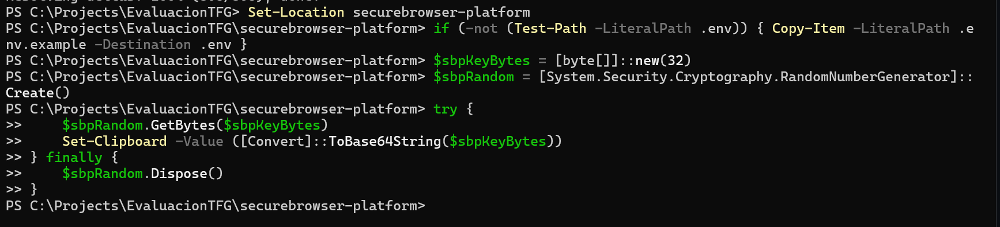

*Preparación de la clave JWT, 28 de noviembre de 2026. La última línea muestra el retorno al prompt. El valor de la clave queda fuera de la captura.*

Completa las dos contraseñas de las cuentas demo y guarda el archivo. Cada una requiere al menos 12 caracteres y admite hasta 72 bytes UTF-8. Si reutilizas un volumen de PostgreSQL, usa las contraseñas con las que se inicializó. [Configuración del backend](../../backend/README.md#entrega-con-docker-compose-bloque-5)

### Arrancar y comprobar los servicios

Usaremos el proyecto de Docker Compose `sbp-evaluacion`. En el primer arranque, Docker crea un volumen de PostgreSQL para esta evaluación. En los siguientes arranques con el mismo nombre, recupera los datos de ese volumen.

Si ya utilizas otro backend local, comprueba qué contenedores están en marcha con `docker ps`. Si alguno publica `127.0.0.1:8081->8080/tcp`, detén ese backend antes de continuar para liberar el puerto. Puedes conservar su base de datos.

```powershell
docker compose -p sbp-evaluacion up --build --detach --wait --wait-timeout 180
docker compose -p sbp-evaluacion ps
docker compose -p sbp-evaluacion port sbp-backend 8080
docker compose -p sbp-evaluacion exec -T sbp-postgres pg_isready -U sbp_app -d securebrowser_db
```

Continúa cuando **sbp-postgres** y **sbp-backend** indiquen `healthy`, el puerto publicado sea `127.0.0.1:8081` y PostgreSQL indique `accepting connections`. El control del backend comprueba que Tomcat acepte conexiones. El login del paso 2 comprueba además que la API responde a una petición real. Si un servicio no arranca, consulta `docker compose -p sbp-evaluacion logs sbp-backend` o `docker compose -p sbp-evaluacion logs sbp-postgres` en tu equipo.

**CAP-01 · Servicios del entorno conectado.** El 28 de noviembre de 2026, los dos contenedores de `sbp-evaluacion` aparecieron como `healthy`. Docker publicó la API en `127.0.0.1:8081` y PostgreSQL respondió `accepting connections`.

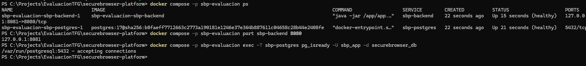

## 2. Abrir Android e iniciar sesión como ADMIN

### Abrir la carpeta del proyecto desde Android Studio

1. Abre **Android Studio** desde el menú Inicio de Windows. En la pantalla de bienvenida, pulsa **Open**. Si ya tienes otro proyecto abierto, elige **File → Open**.
2. En la ventana de selección, ve a la ubicación donde creaste **EvaluacionTFG**. Entra en **EvaluacionTFG → securebrowser-platform** y selecciona la carpeta **android**. En el equipo de esta prueba la ruta completa es `C:\Projects\EvaluacionTFG\securebrowser-platform\android`.

   **CAP-02a · Carpeta seleccionada.** En la ventana **Open File or Project** se ve la carpeta **android** seleccionada dentro de **EvaluacionTFG → securebrowser-platform**. El botón **Select Folder** aparece abajo a la derecha.

   <p align="center">
     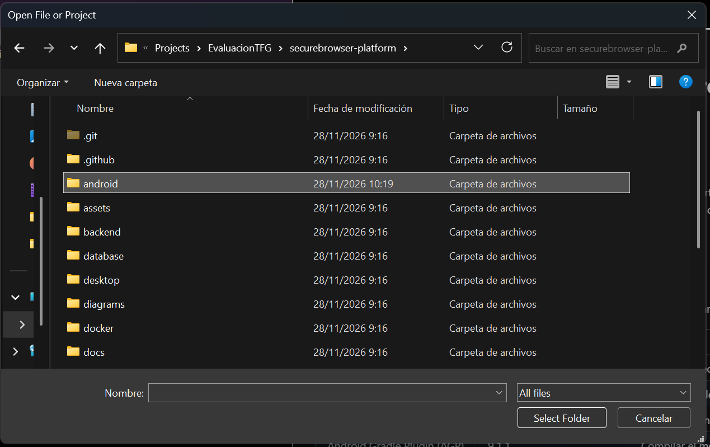
   </p>

3. Pulsa **Select Folder** (Seleccionar carpeta) para abrir **android** como proyecto. Esa carpeta contiene `settings.gradle.kts`. Espera a que Android Studio termine la sincronización de Gradle y comprueba que aparece el módulo **app** en el panel del proyecto.

### Iniciar el emulador y entrar como ADMIN

1. En Android Studio, pulsa **Ctrl+Mayús+A**, escribe **Device Manager** y abre esa herramienta. En la lista de dispositivos virtuales, localiza **Medium Phone API 36.1** y pulsa el botón **▶** de su fila para iniciarlo. Si aún no tienes ese dispositivo, créalo con el perfil **Medium Phone** y una imagen de sistema **API 36.1**. Espera a ver la pantalla de inicio de Android. El APK Debug utiliza `http://10.0.2.2:8081/api/v1/` para llegar al PC desde el emulador.
2. En la barra superior de Android Studio, selecciona la configuración **app** y el emulador que acabas de iniciar.

3. Con la variante **debug**, pulsa **▶ Run**, el triángulo verde a la derecha de **app**. Android Studio compila la aplicación, la instala en el emulador y la abre. Espera a que aparezca la pantalla de inicio de sesión.

   **CAP-02b · Ejecutar la app en el emulador.** De izquierda a derecha se ven el dispositivo **Medium Phone API 36.1**, la configuración **app** y el botón **▶ Run**.

   <p align="center">
     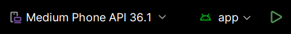
   </p>

4. En la app, introduce **admin@demo.local** y la contraseña que configuraste en `SBP_DEMO_ADMIN_PASSWORD`. Pulsa **Entrar**. Cuando se abra **Panel de usuario**, comprueba que aparece **Rol: ADMIN**.

   **CAP-03 · Panel de administración tras el login.** La cuenta **Admin Demo** tiene acceso a **Dispositivos**, **Catálogo de políticas** y **Eventos de seguridad**.

   <p align="center">
     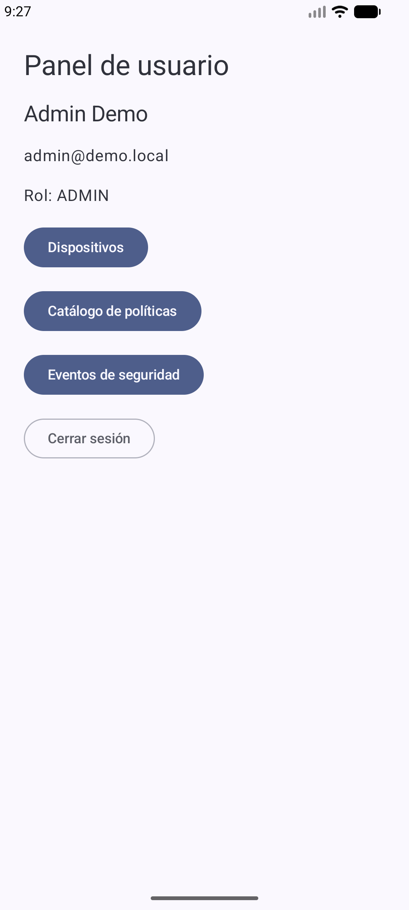
   </p>

5. Pulsa **Dispositivos**, localiza **Desktop Demo** y anota el ID que aparezca en tu pantalla. En la evaluación del 28/11/2026 se observó **ID 1**. Más adelante buscarás ese mismo identificador en el historial de eventos de tu sesión.

## 3. Abrir Desktop conectado como USER

### 3.1 Comprobar Git y Python en el clon de evaluación

**Git** es la herramienta de control de versiones que utilizaste para clonar el repositorio. **Python** es el lenguaje en el que está escrita la herramienta que descarga Qt.

Mantén Docker y el emulador de Android en marcha. Desde PowerShell, en la carpeta `EvaluacionTFG\securebrowser-platform`, comprueba las versiones instaladas.

```powershell
git --version
python --version
```

La terminal debe mostrar ambas versiones. Python 3.10 o posterior permite preparar Qt. En el equipo de evaluación se obtuvieron `git version 2.48.1.windows.1` y `Python 3.13.3`.

### 3.2 Comprobar el compilador de C++

**MSVC** es el compilador de Microsoft que convierte el código C++ de Desktop en instrucciones para el procesador. Para comprobar si tienes las herramientas **v143 para x64 de Visual Studio 2022**, ejecuta este bloque en la misma PowerShell.

```powershell
$vswhere = "${env:ProgramFiles(x86)}\Microsoft Visual Studio\Installer\vswhere.exe"
& $vswhere -products '*' -version '[17.0,18.0)' -requires Microsoft.VisualStudio.Component.VC.Tools.x86.x64 -property installationPath
```

Si aparece una ruta de Visual Studio 2022, se han localizado las herramientas de C++. Si la salida está vacía o PowerShell indica que no encuentra `vswhere.exe`, sigue los pasos para [instalar el compilador de C++](#instalar-el-compilador-de-c) al principio de esta guía y vuelve a ejecutar el bloque.

En el equipo de evaluación, el comando devolvió `C:\Program Files (x86)\Microsoft Visual Studio\2022\BuildTools`.

### 3.3 Comprobar el Windows SDK

El **Windows SDK** es el kit de desarrollo de Microsoft que aporta las cabeceras y bibliotecas necesarias para usar funciones de Windows desde Desktop. Desde la misma PowerShell, ejecuta esta comprobación de solo lectura.

```powershell
.\desktop\ci\setup-windows-sdk.ps1 -CheckOnly
```

Si aparece `Windows SDK 10.0.28000.2270 ya está preparado`, puedes continuar. Si aparece `Falta Windows SDK`, abre PowerShell como administrador en la raíz del clon y ejecuta `.\desktop\ci\setup-windows-sdk.ps1` para instalarlo. Vuelve a la terminal habitual y repite la comprobación.

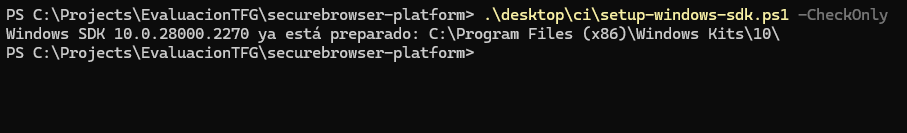

### 3.4 Comprobar 7-Zip

**7-Zip** es un programa para comprimir y extraer archivos. Aquí lo usamos para extraer el paquete de CEF. En la misma PowerShell, ejecuta estas dos líneas para ver la versión instalada.

```powershell
$sevenZipExecutable = Join-Path $env:ProgramFiles '7-Zip/7z.exe'
(Get-Item -LiteralPath $sevenZipExecutable -ErrorAction Stop).VersionInfo.FileVersion
```

La segunda línea debe mostrar un número de versión. Si PowerShell indica que la ruta no existe, instala **7-Zip para Windows x64** en la carpeta predeterminada y repite el bloque. [Descarga de 7-Zip](https://www.7-zip.org/download.html)

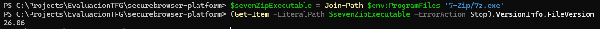

### 3.5 Preparar CMake

**CMake** es la herramienta que lee las instrucciones de compilación de Desktop y genera el proyecto de Visual Studio. Desde la misma PowerShell, ejecuta el siguiente bloque. El script reutiliza la versión `3.29.2` si está disponible o la descarga si hace falta.

```powershell
.\desktop\ci\setup-cmake.ps1
if ($LASTEXITCODE -ne 0) { throw 'La preparación de CMake ha fallado.' }
cmake --version
```

Comprueba que la salida de `cmake --version` empieza por `cmake version 3.29.2`. Mantén abierta esta PowerShell para los pasos siguientes, porque el script selecciona CMake para esta sesión.

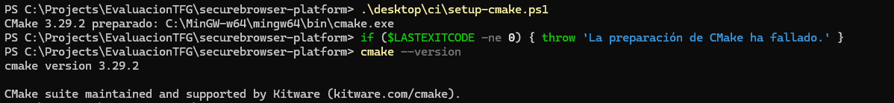

### 3.6 Preparar Qt

**Qt** es un framework de C++ que Desktop utiliza para mostrar ventanas, como la de inicio de sesión, y enviar peticiones HTTP al backend.

En la misma PowerShell, ejecuta este bloque. La primera línea prepara el kit de Qt para Visual Studio 2022 de 64 bits. Si aún no está en este clon, el script lo descarga. La última línea guarda su ruta para configurar el proyecto más adelante.

```powershell
.\desktop\ci\setup-qt.ps1
if ($LASTEXITCODE -ne 0) { throw 'La preparación de Qt ha fallado.' }
$qtKitDirectory = (Resolve-Path -LiteralPath 'desktop/.deps/qt/6.12.0/msvc2022_64').Path
```

Al terminar el script, busca el mensaje `Kit Qt 6.12.0 MSVC x64 preparado:` seguido de la ruta del kit. Mantén abierta esta PowerShell para conservar `$qtKitDirectory`.

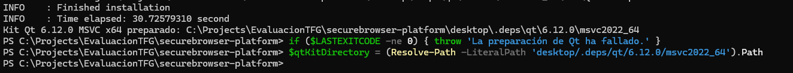

### 3.7 Preparar CEF y compilar Desktop en Release

#### 3.7.1 Preparar el motor del navegador (CEF)

**CEF** (*Chromium Embedded Framework*) permite integrar Chromium en Desktop para cargar y mostrar las páginas web dentro de la ventana.

En la misma PowerShell, ejecuta este bloque. El script utiliza el 7-Zip del paso 3.4 para extraer CEF. La primera descarga ocupa unos 367 MB. Si el clon ya contiene un SDK válido, el script lo reutiliza.

```powershell
.\scripts\setup-cef.ps1 -ArchiveExtractor SevenZip -SevenZipExecutable $sevenZipExecutable
if (-not $?) { throw 'La preparación de CEF ha fallado.' }
```

Espera a que aparezca la línea final `CEF_ROOT:` con la ruta dentro de `desktop\.deps\cef`. La línea inicial `CEF_ROOT (planned)` indica dónde se prevé instalar el SDK.

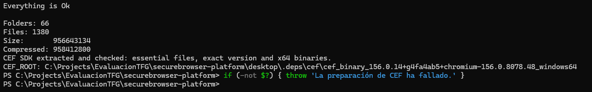

#### 3.7.2 Guardar la ruta de CEF para CMake

En la misma PowerShell, ejecuta el bloque. Lee el nombre del paquete desde el manifiesto del proyecto y localiza la carpeta que acabas de extraer. La última línea muestra la ruta guardada.

```powershell
$cefManifest = Get-Content -LiteralPath 'desktop/cef-sdk.json' -Raw -Encoding UTF8 | ConvertFrom-Json
$cefDirectoryName = $cefManifest.archive -replace '\.tar\.bz2$', ''
$cefRoot = (Resolve-Path -LiteralPath (Join-Path 'desktop/.deps/cef' $cefDirectoryName)).Path
$cefRoot
```

Comprueba que la ruta coincide con la que el script mostró junto a `CEF_ROOT:` en el paso 3.7.1. Mantén abierta la terminal para usar `$cefRoot` al configurar CMake.

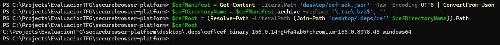

#### 3.7.3 Preparar ICU

**ICU** (*International Components for Unicode*) es una biblioteca para trabajar con texto Unicode. Desktop la usa para convertir las extensiones a minúsculas y aplicar la misma regla a archivos como `informe.PDF` e `informe.pdf`.

En la misma PowerShell, ejecuta este bloque. El script descarga y verifica el paquete si hace falta, o comprueba la instalación existente.

```powershell
.\scripts\setup-icu.ps1
if (-not $?) { throw 'La preparación de ICU ha fallado.' }
```

Al finalizar, busca la línea `SBP_ICU_ROOT:`. La ruta debe terminar en `desktop\.deps\icu\icu4c-76_1-Win64-MSVC2022`. CMake buscará ICU directamente en esa carpeta.

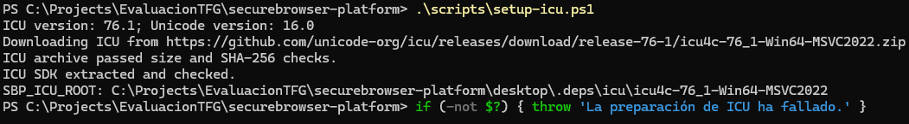

#### 3.7.4 Configurar el proyecto con CMake

Desde la misma PowerShell, ejecuta el bloque. El script utiliza las rutas de Qt y CEF que guardaste y localiza ICU en su carpeta predeterminada. CMake genera los archivos del proyecto de Visual Studio en `desktop/build/`.

```powershell
.\desktop\ci\configure.ps1 -QtKitDirectory $qtKitDirectory -CefRoot $cefRoot
if ($LASTEXITCODE -ne 0) { throw 'La configuración de CMake ha fallado.' }
```

Cuando termine, busca `Generating done` y la línea `Build files have been written to:` con la ruta a `desktop/build`.

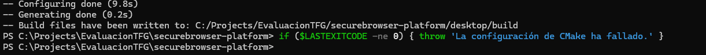

#### 3.7.5 Compilar Desktop en Release

**Release** es la configuración optimizada que usaremos para la evaluación. Desde la misma PowerShell, ejecuta el bloque. CMake compila el navegador y prepara la carpeta `desktop/build/Release` con el ejecutable y las bibliotecas que necesita para arrancar.

```powershell
cmake --build desktop/build --config Release --target SecureBrowser --parallel 4
if ($LASTEXITCODE -ne 0) { throw 'La compilación de Desktop en Release ha fallado.' }
(Get-Item -LiteralPath '.\desktop\build\Release\SecureBrowser.exe' -ErrorAction Stop).FullName
```

La última línea muestra la ruta completa del ejecutable. Cuando termine la compilación sin errores y veas la ruta que acaba en `desktop\build\Release\SecureBrowser.exe`, continúa con el paso 3.8.

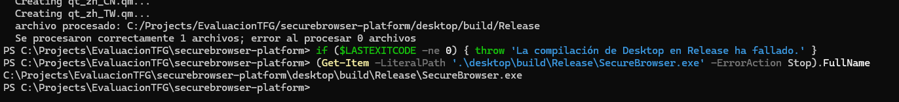

### 3.8 Iniciar el navegador con la configuración del dispositivo

Mantén en marcha los servicios de Docker y el emulador de Android. Cierra cualquier ventana de SecureBrowser Desktop que tengas abierta.

Desde la raíz del repositorio, ejecuta estas dos líneas en la misma ventana de PowerShell. La primera indica dónde encontrar la dirección de la API (`127.0.0.1:8081`) y el UUID del dispositivo **Desktop Demo**. La segunda abre el navegador con esa configuración. [Configuración del dispositivo](../../desktop/config/backend-demo.ini)

```powershell
$env:SBP_BACKEND_CONFIG = (Resolve-Path '.\desktop\config\backend-demo.ini').Path
.\desktop\build\Release\SecureBrowser.exe
```

Al abrirse Desktop, verás el diálogo **Iniciar sesión** con los campos **Correo** y **Contraseña**.

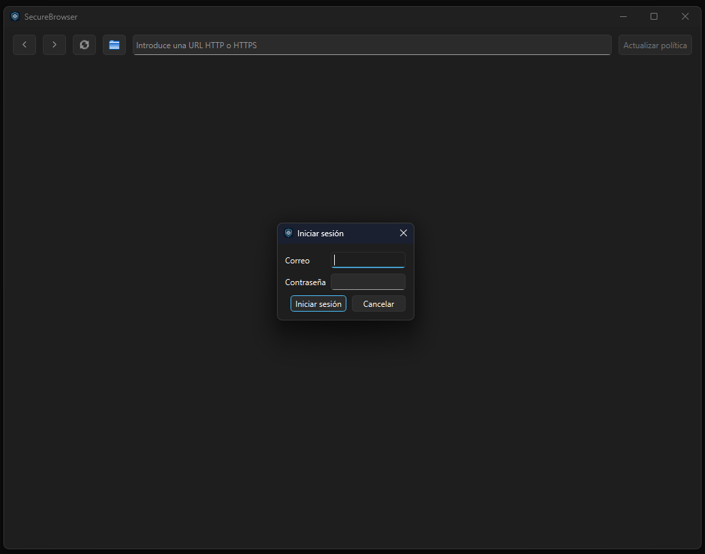

### 3.9 Iniciar sesión como USER y comprobar la política aplicada

1. En **Correo**, escribe `user@demo.local`.
2. En **Contraseña**, introduce la que guardaste en `SBP_DEMO_USER_PASSWORD` en el archivo `.env` de evaluación. Pulsa **Iniciar sesión**.
3. Espera a que el título de la ventana muestre **SecureBrowser — Política aplicada:** seguido del nombre de la política. Anota ese nombre para localizarla después en Android. Si la política permite navegar a Inicio, se abre Google. [Prueba de aplicación de política](https://github.com/CristianPG1993/securebrowser-platform/pull/157)

**CAP-05 · Política aplicada al dispositivo.** En la evaluación del 28/11/2026, el título mostró **SecureBrowser — Política aplicada: Política demo**. Se abrió Google como página de inicio y quedó visible el botón **Actualizar política**.

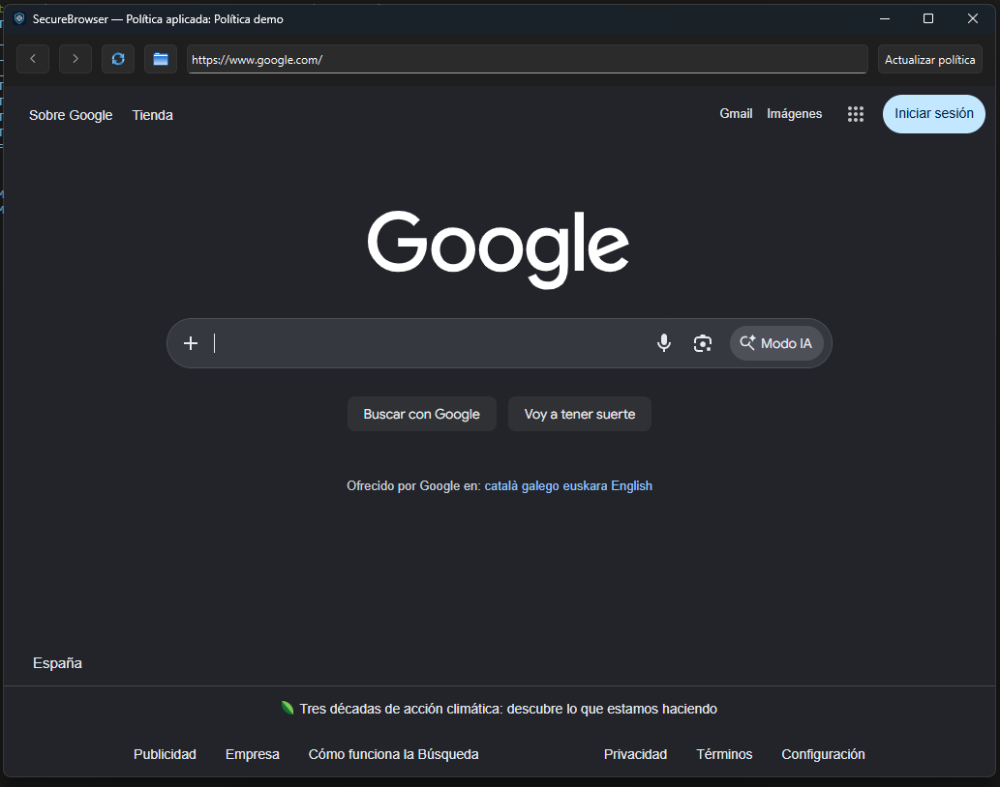

## 4. Cambiar las reglas y comprobar dos bloqueos

**Al volver a Android después de preparar Desktop**, es posible que tengas que iniciar sesión de nuevo. Con la configuración de la demo, el token de acceso caduca a los **15 minutos** desde que se emite. Si ha caducado, la próxima vez que la app consulte el backend verás el aviso **«Tu sesión ya no es válida. Vuelve a iniciar sesión.»**

Si aparece ese aviso, escribe `admin@demo.local` y la contraseña que guardaste en `SBP_DEMO_ADMIN_PASSWORD` en el `.env` de evaluación. Pulsa **Entrar** para volver al panel de ADMIN.

<p align="center">
  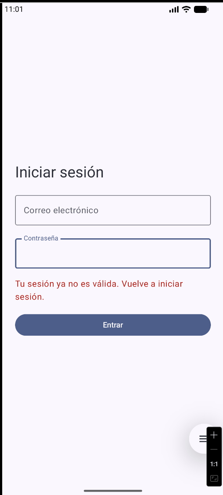
</p>

Desde el panel de ADMIN, abre **Catálogo de políticas** y selecciona la política cuyo nombre viste en el paso 3.9 (**Política demo** en esta evaluación). Antes de pulsar **Editar**, anota el estado, el modo de lista y las reglas de **Filtro de URL** y **Control de descargas**. Así podrás restaurar la configuración al terminar.

**Estado inicial de Política demo.** En esta evaluación, ambos controles estaban activados en modo **Lista de bloqueo**. El único dominio de la lista era `blocked.example` y la única extensión era `exe`.

<p align="center">
  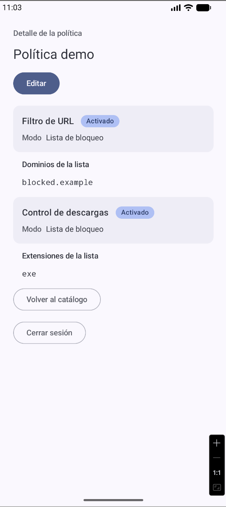
</p>

**Comprobar la navegación antes del cambio.** Para esta prueba, parte de una política que permita `as.com`, Google, Samplelib y los PDF. Si alguna regla ya impide el ejemplo, ajusta primero la política en Android, guarda y pulsa **Actualizar política** en Desktop. Abre `https://as.com/` en Desktop y deja la página abierta mientras editas la política desde Android.

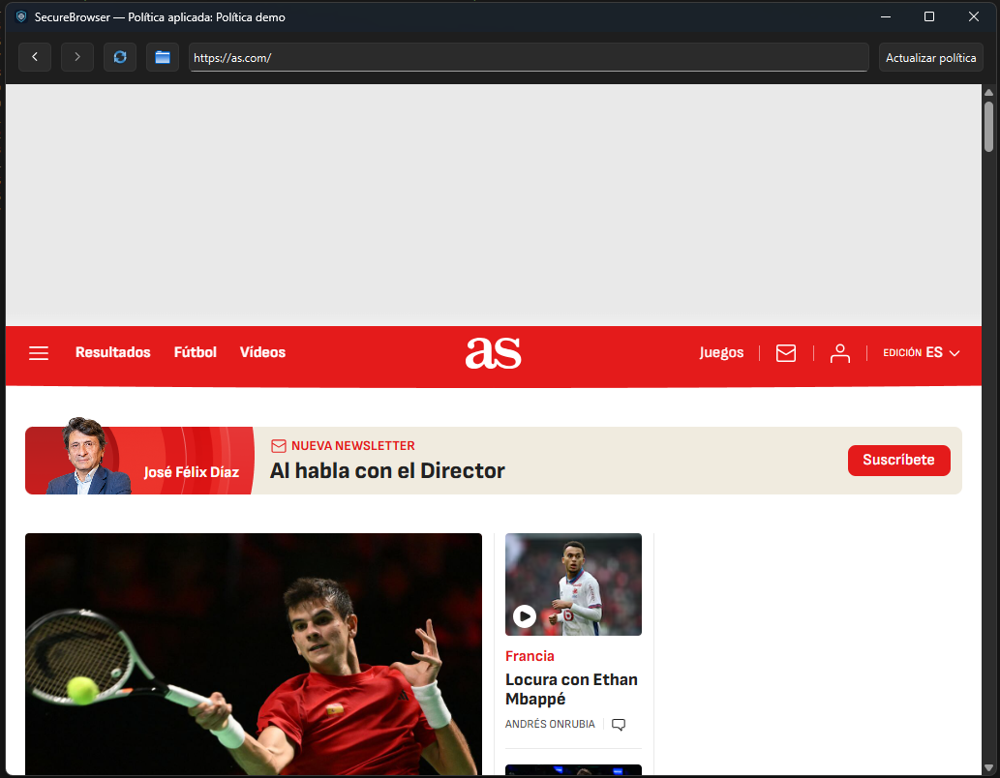

**Editar las dos reglas en Android.** Pulsa **Editar**. Con **Filtro de URL** activado en modo **Lista de bloqueo**, añade `as.com` en una línea nueva de **Dominios (uno por línea)**. Conserva los dominios anteriores.

**CAP-04 · Regla de URL antes de guardar.** En el editor de **Política demo** se ven `blocked.example` y `as.com`. En este punto, la lista de extensiones todavía contiene solo `exe`.

<p align="center">
  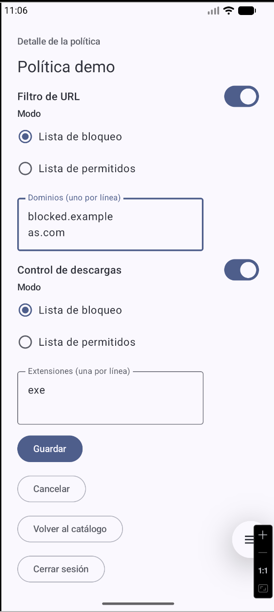
</p>

En **Control de descargas**, comprueba que está activado en modo **Lista de bloqueo**. En **Extensiones (una por línea)**, conserva `exe` y añade `pdf` en la línea siguiente, sin punto. Pulsa **Guardar** una vez para enviar ambos cambios. Espera a que el detalle muestre **Cambios confirmados** y comprueba que aparecen `as.com` y `pdf` en sus respectivas listas.

**CAP-04b · Cambios confirmados en Android.** En **Política demo** aparecen los dominios `as.com` y `blocked.example` y las extensiones `exe` y `pdf`. Ambos controles siguen activados en modo **Lista de bloqueo**.

<p align="center">
  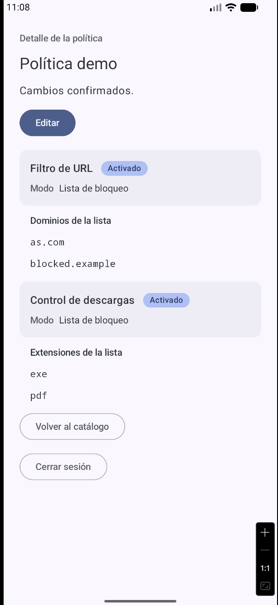
</p>

| Comprobación | Acción | Resultado que debes observar |
| --- | --- | --- |
| Bloqueo de navegación | Con la página de `as.com` abierta, pulsa **Actualizar política** en Desktop. Si hace falta, vuelve a introducir la dirección. | Aparece **Navegación bloqueada** con el motivo y el nombre de la política. Pulsa **OK** y comprueba la vuelta a Inicio. |
| Bloqueo de descarga | Abre [la página de PDF de Samplelib](https://samplelib.com/es/sample-pdf.html) y pulsa la flecha de descarga del PDF de una página. | Aparece **Descarga bloqueada** por extensión. En este recorrido la propia extensión propuesta, `pdf`, ya está prohibida. Pulsa **OK**. |

**CAP-06 · Navegación bloqueada.** Tras actualizar **Política demo**, Desktop retiró la página de AS que estaba abierta. El aviso **Bloqueo de seguridad** identifica el dominio `as.com` y la política que lo bloqueó.

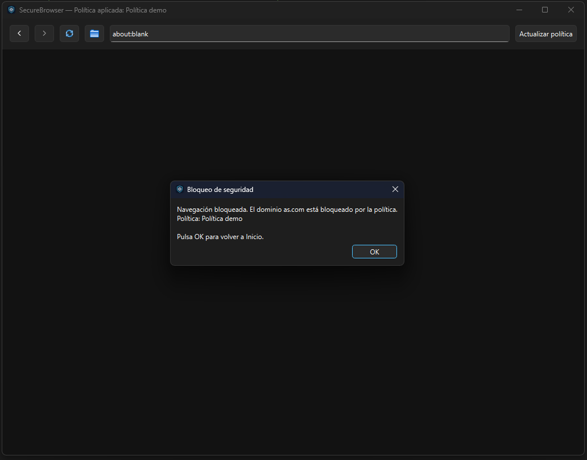

Al pulsar **OK** en este aviso, se comprobó en Desktop que volvió a abrirse la página de inicio, Google.

Para probar la descarga del PDF, copia esta URL, pégala en la barra de direcciones de **SecureBrowser Desktop** y pulsa **Intro**.

```text
https://samplelib.com/es/sample-pdf.html
```

En la fila **Documento PDF con texto, 1 página**, pulsa el botón de la flecha hacia abajo.

**CAP-07 · Descarga bloqueada.** En la página de PDF de Samplelib, Desktop mostró **Descarga bloqueada**. El aviso señaló la extensión del archivo como motivo e identificó **Política demo**. Pulsa **OK** y comprueba que vuelves a Google.

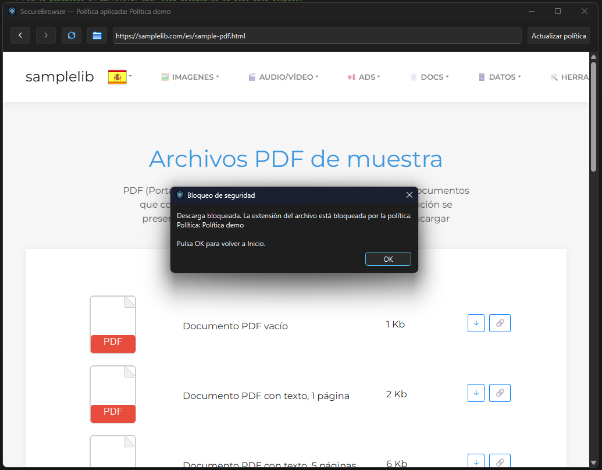

En esta evaluación se confirmó que, al pulsar **OK** en el aviso de descarga, Desktop volvió a la página de inicio.

## 5. Localizar ambos eventos y cerrar el entorno

En Android vuelve al panel y abre **Eventos de seguridad**. Selecciona **Todos** para ver **URL bloqueada** y **Descarga bloqueada**. Contrasta el identificador del dispositivo del paso 2 y las horas UTC de tus dos acciones. Si el historial estaba abierto antes de la prueba, vuelve al panel y entra de nuevo. Una entrada antigua de otro dispositivo no acredita esta sesión. [Registro de ambos bloqueos](https://github.com/CristianPG1993/securebrowser-platform/pull/158)

**CAP-08 · Historial de los dos bloqueos.** El 28/11/2026, Android mostró **URL bloqueada** a las 11:09:52.186442 UTC y **Descarga bloqueada** a las 11:13:24.822835 UTC. Las dos entradas correspondían al **Dispositivo 1**, identificado en el paso 2.

<p align="center">
  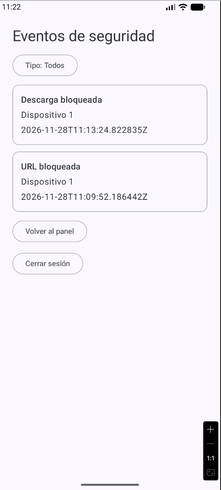
</p>

**Restaurar la política.** En Android, pulsa **Volver al panel → Catálogo de políticas → Política demo → Editar**. Recupera las listas, los modos y los estados que anotaste antes de la prueba. En esta evaluación basta con quitar `as.com` de los dominios y `pdf` de las extensiones. Deben quedar `blocked.example` y `exe`, con ambos controles activados en **Lista de bloqueo**. Pulsa **Guardar** y espera **Cambios confirmados**.

En esta evaluación se confirmó manualmente el guardado de la configuración inicial en Android.

En Desktop pulsa **Actualizar política** para cargar las reglas restauradas. Puedes comprobar el cambio abriendo de nuevo `https://as.com/`: con la configuración inicial, la página debe volver a cargar.

En la comprobación manual del 28/11/2026, la portada de AS volvió a cargar después de actualizar Desktop con la política restaurada.

Para cerrar el entorno, cierra Desktop con la X y pulsa **Cerrar sesión** en Android. Desde la raíz del repositorio ejecuta lo siguiente. Se conservan los datos de PostgreSQL en su volumen.

```powershell
Remove-Item Env:SBP_BACKEND_CONFIG -ErrorAction SilentlyContinue
docker compose -p sbp-evaluacion down
```

En la evaluación, Docker mostró `down 3/3`: retiró el contenedor del backend, el de PostgreSQL y la red `sbp-evaluacion_default`. Al ejecutar `down` sin la opción `-v`, Compose conserva el volumen de datos de PostgreSQL para el siguiente arranque.

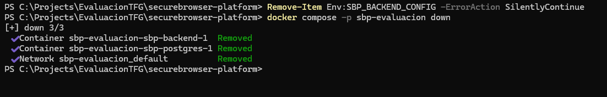
