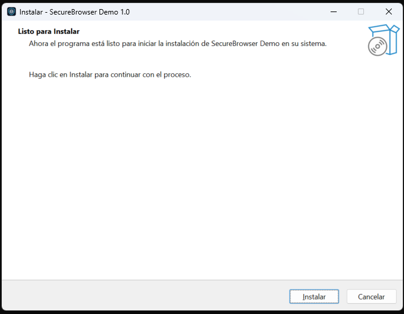
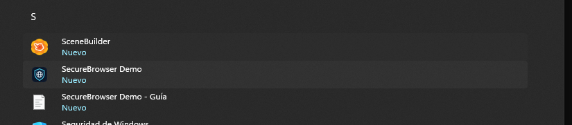
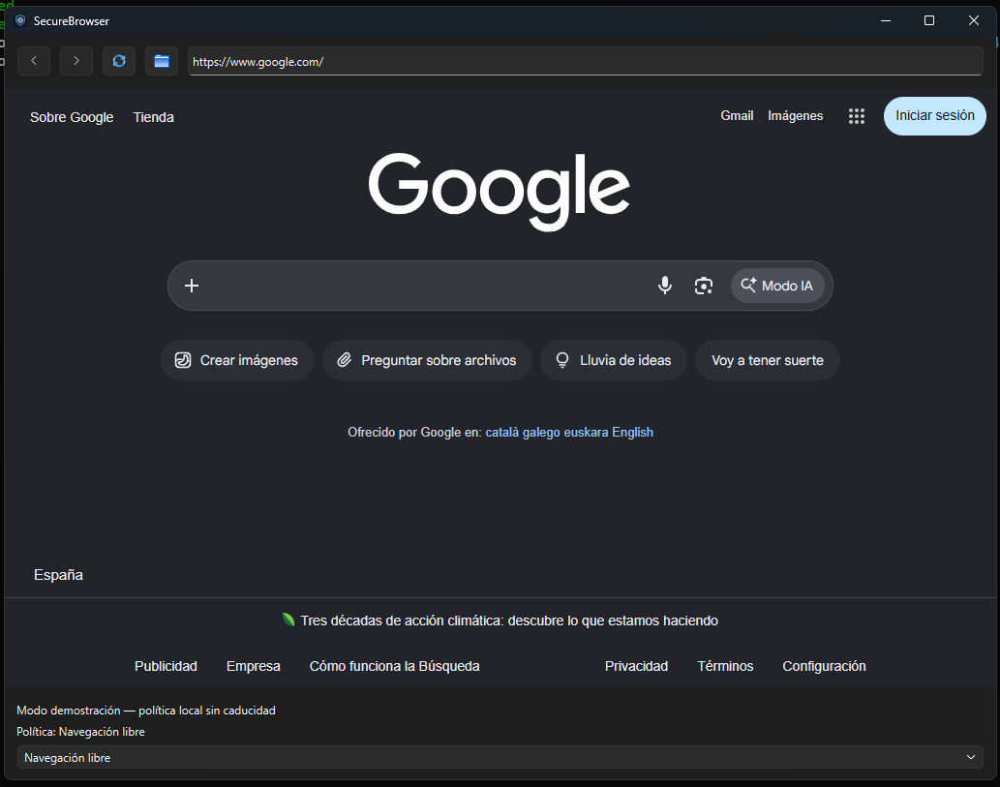
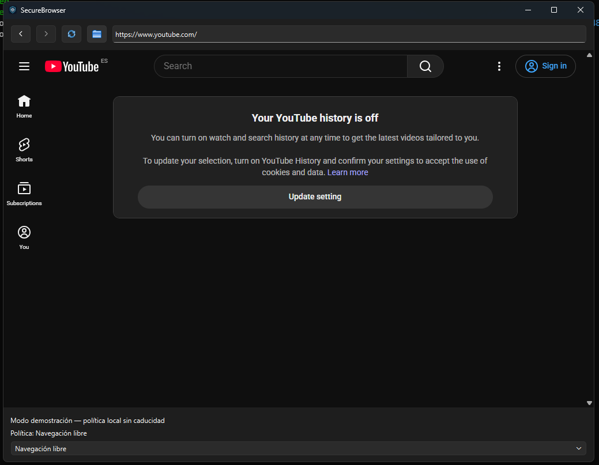
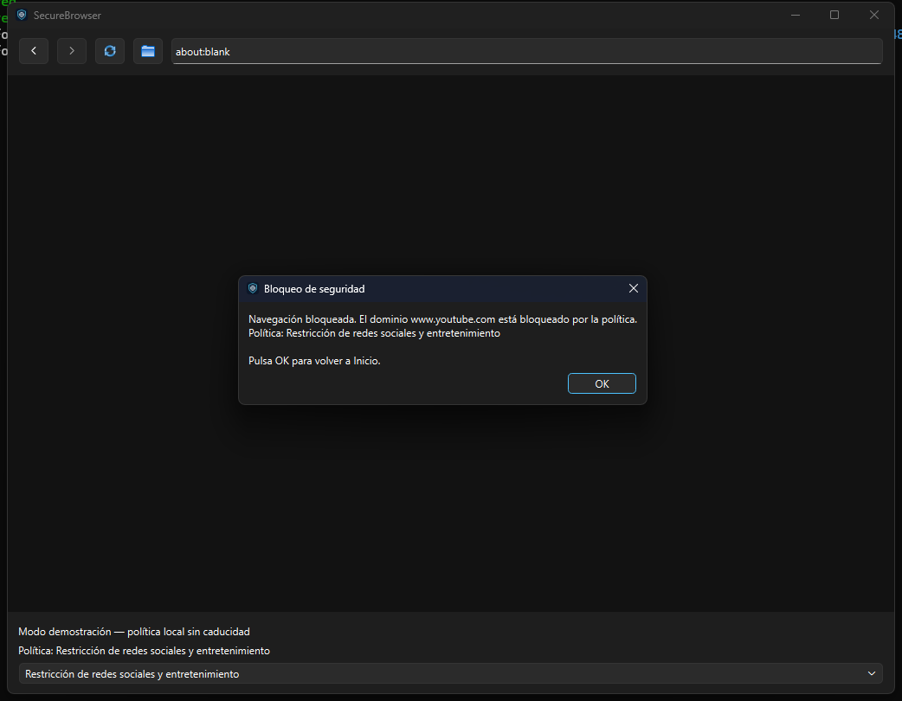
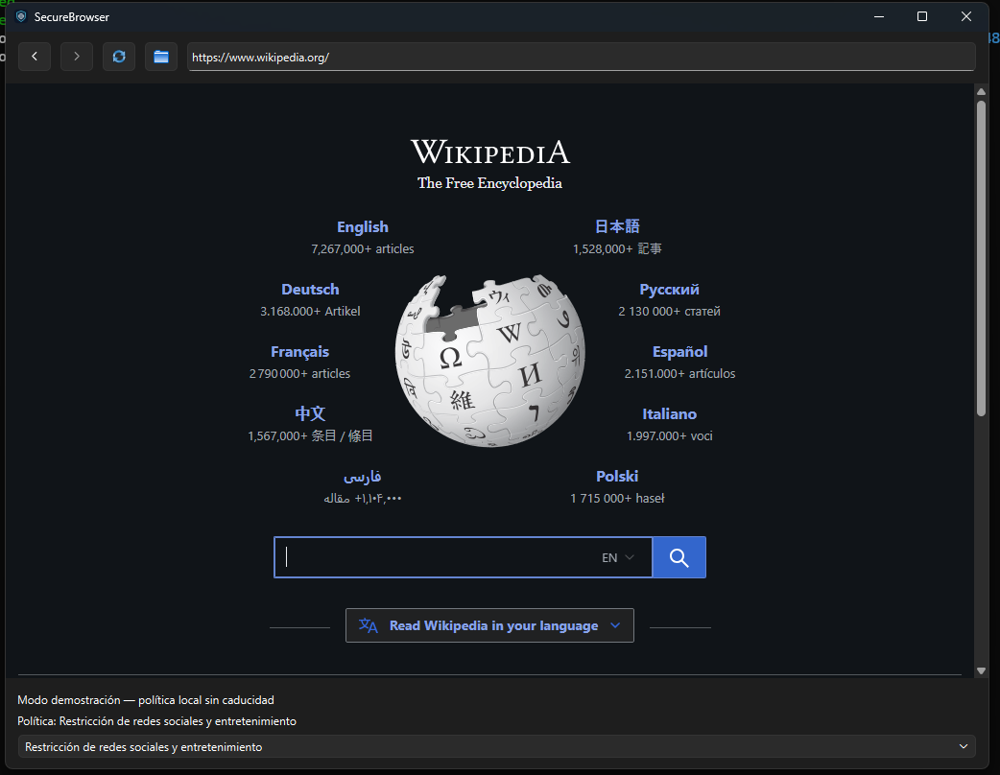
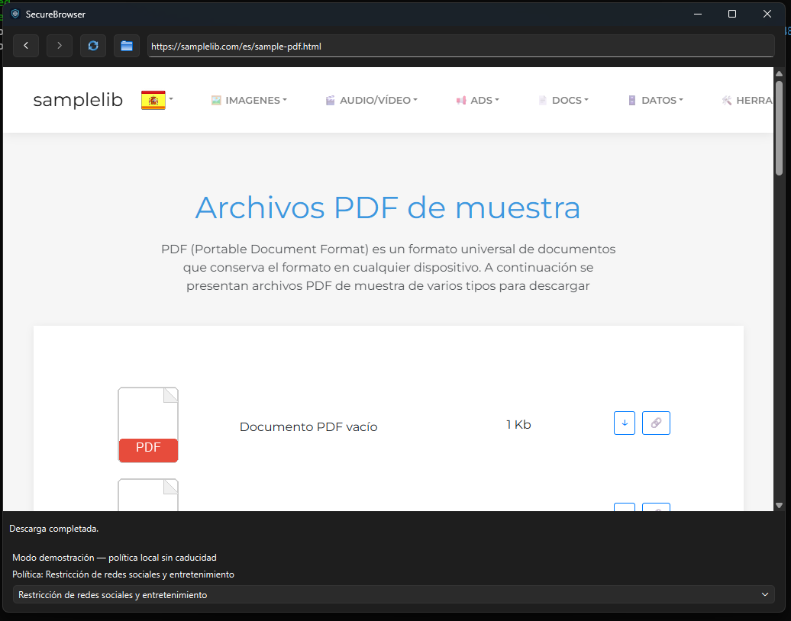
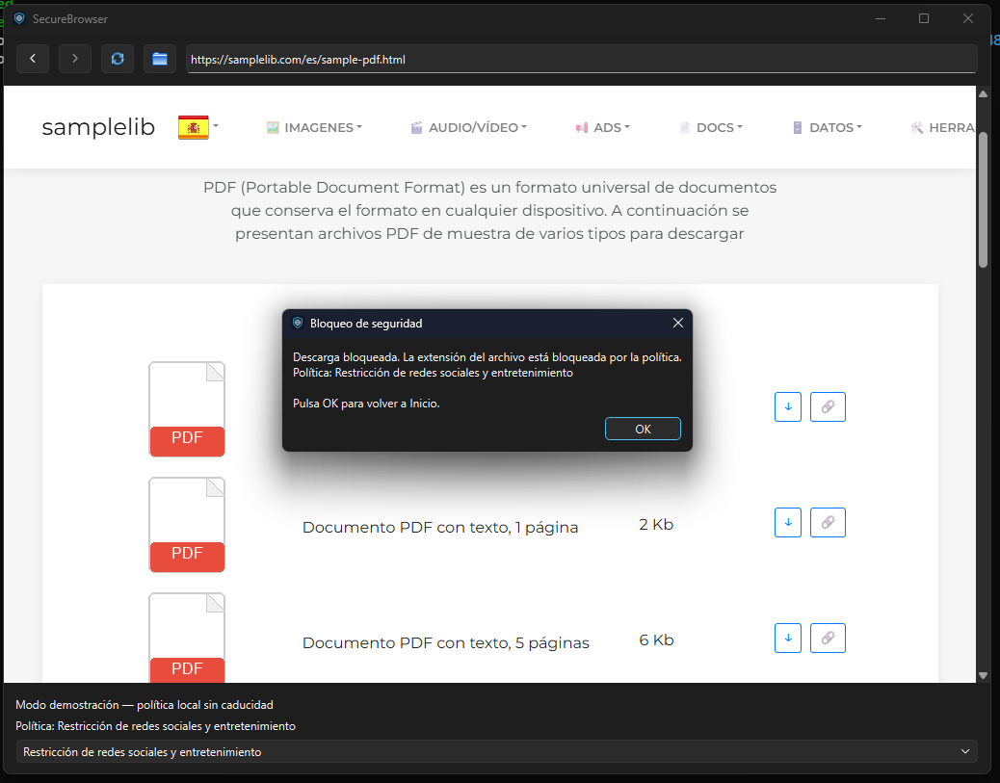

# Guía de evaluación de la demo autónoma de SecureBrowser Desktop

En esta demo probarás dos políticas incluidas en el navegador. Primero abrirás YouTube y cambiarás de política para comprobar cuándo se bloquea. Después descargarás el mismo PDF con dos nombres distintos para ver cómo influye la extensión elegida en **Guardar como**.

## 1. Instalar y abrir la demo

Necesitas **Windows 11 x64**, el archivo **SecureBrowser-Setup.exe** y conexión a Internet para visitar las páginas de prueba. Las políticas funcionan en el propio equipo. Puedes dejar Docker y Android cerrados durante toda la evaluación.

### 1.1 Instalar SecureBrowser Demo

Abre **SecureBrowser-Setup.exe**. Cuando el asistente muestre **Listo para Instalar**, pulsa **Instalar**. Espera a que termine y pulsa **Finalizar**. El instalador prepara la aplicación para tu cuenta de Windows.



### 1.2 Abrir el navegador desde Inicio

Pulsa la tecla **Windows**, escribe **SecureBrowser Demo** y abre la aplicación. En **Inicio → Todas las aplicaciones**, bajo la letra **S**, encontrarás también **SecureBrowser Demo - Guía**, que abre las instrucciones breves instaladas.



En la parte inferior de la ventana busca **Modo demostración**. El selector debe mostrar **Navegación libre**. Usarás ese selector para cambiar de política durante las pruebas.



## 2. Qué contiene cada política

| Política del selector | Navegación | Descargas |
| --- | --- | --- |
| **Navegación libre** | Filtro de dominios desactivado. | Filtro de extensiones desactivado. |
| **Restricción de redes sociales y entretenimiento** | Bloquea `facebook.com`, `instagram.com`, `tiktok.com`, `x.com`, `youtube.com`, `twitch.tv`, `netflix.com` y sus subdominios. | Bloquea `.exe` y `.msi`. Comprueba tanto el nombre sugerido por la web como el que eliges al guardar. Permite `.pdf`. |

## 3. Prueba de navegación

### 3.1 Abrir YouTube con Navegación libre

Con **Navegación libre** seleccionada, copia esta dirección en la barra de SecureBrowser y pulsa **Intro**.

```text
https://www.youtube.com/
```

**Qué comprobar.** Carga YouTube. Si aparece su aviso de cookies, también has llegado al sitio. Deja esta página abierta.



### 3.2 Aplicar la política restrictiva

En el selector inferior, elige **Restricción de redes sociales y entretenimiento**. Si hace falta, vuelve a introducir la dirección de YouTube. Comprueba que aparece **Navegación bloqueada** y que el aviso identifica el dominio y la política.



Pulsa **OK** para volver a Inicio. En la evaluación del 28/11/2026 se confirmó que el aviso se cerró y volvió a mostrarse Google.

### 3.3 Comprobar un dominio permitido y volver a la política libre

Mantén seleccionada la política restrictiva y abre esta dirección. Wikipedia debe cargar.

```text
https://www.wikipedia.org/
```



Vuelve a seleccionar **Navegación libre** y abre de nuevo la dirección de YouTube del paso 3.1. En la evaluación del 28/11/2026 se confirmó que YouTube volvió a cargar.

## 4. Prueba de descarga

### 4.1 Guardar el PDF con una extensión permitida

Selecciona **Restricción de redes sociales y entretenimiento** y abre la página de PDF de Samplelib.

```text
https://samplelib.com/es/sample-pdf.html
```

1. Busca la fila **Documento PDF con texto, 1 página** y pulsa su **flecha de descarga**.
2. En **Guardar como**, elige **Documentos** y escribe `prueba.pdf`. Para distinguir los archivos de esta prueba, puedes usar una carpeta vacía dentro de Documentos.
3. Pulsa **Guardar**. Espera el aviso **Descarga completada** y comprueba en el Explorador que `prueba.pdf` está en la carpeta elegida.



### 4.2 Repetir la descarga con una extensión bloqueada

Con la misma política, pulsa otra vez la flecha del mismo PDF. En **Guardar como**, elige la misma carpeta, selecciona el nombre completo y sustitúyelo por `prueba.exe`. Pulsa **Guardar**.

**Qué comprobar.** SecureBrowser muestra **Descarga bloqueada** por la extensión del nombre elegido.



Pulsa **OK** para volver a Inicio. En el Explorador, abre la carpeta que elegiste en **Guardar como** y comprueba que se conserva `prueba.pdf` y que no se ha creado `prueba.exe`.

En la prueba del 28/11/2026 se confirmó que, al pulsar **OK**, el navegador volvió a Google. En la carpeta de destino seguía `prueba.pdf` y no apareció `prueba.exe`.

## 5. Cerrar la demo

Cierra SecureBrowser con la **X**. Si quieres retirar la aplicación instalada, abre **Configuración → Aplicaciones → Aplicaciones instaladas → SecureBrowser Demo → Desinstalar**. Los archivos descargados y el perfil local de navegación permanecen en tu cuenta de Windows.
